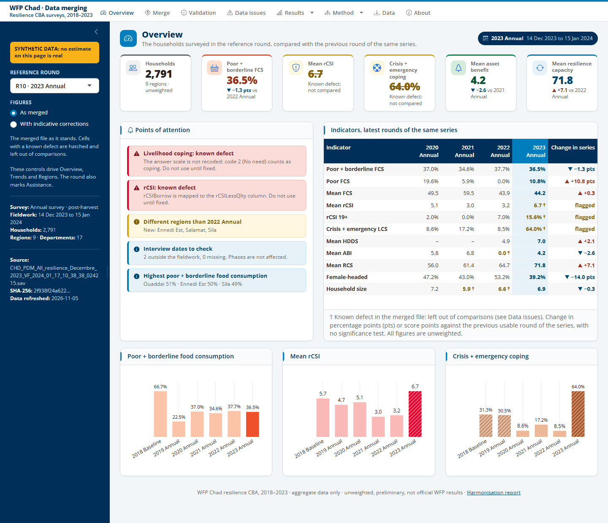
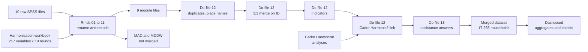

# WFP Chad resilience CBA: household survey data merging, 2018–2023


This repository builds the household dataset for the cost-benefit analysis (CBA) of WFP's resilience interventions in Chad. It merges **10 survey rounds** into one file of **17,255 households and 305 columns**, documents the problems found on the way, and checks the result in a dashboard.

| Part | What it is | Where |
|---|---|---|
| Harmonisation | R Markdown files that rename and recode each module, round by round | `01_` to `11_*.Rmd` |
| Merge | Stata do-files that clean, merge and compute the indicators | `12_*.do`, `13_*.do` |
| Report | Bookdown report on harmonisation issues | [Read online](https://bookdown.org/aboubacarhema94/WFP_Chad_Cost_Benefit_Analysis_data_merging/) |
| Dashboard | R Shiny app showing the merge, its checks and the results | [`app/`](app/README.md) |



*The dashboard's Overview page. The estimates in this screenshot are synthetic.*

> **Read this before using the merged file.** An audit found defects in the merged file dated 23 April 2025 that change results in several rounds. They are not yet fixed in the pipeline. See [Known issues](#known-issues).

## Contents

- [How the data are built](#how-the-data-are-built)
- [Survey rounds](#survey-rounds)
- [Modules](#modules)
- [Known issues](#known-issues)
- [Data](#data)
- [Reproduce the merge](#reproduce-the-merge)
- [Run the dashboard](#run-the-dashboard)
- [Repository structure](#repository-structure)
- [Contact](#contact)

## How the data are built



## Survey rounds

| Round | Survey | Series | Main fieldwork | Households |
|---|---|---|---|---:|
| R1 | 2018 Baseline | Post-harvest | Nov to Dec 2018 | 3,979 |
| R2 | 2019 Annual | Post-harvest | Nov 2019 | 775 |
| R3 | 2020 PDM | Lean season | Jul to Aug 2020 | 271 |
| R4 | 2020 Annual | Post-harvest | Jan to Feb 2021 | 1,063 |
| R5 | 2021 PDM | Lean season | Aug 2021 | 786 |
| R6 | 2021 Annual | Post-harvest | Dec 2021 to Jan 2022 | 1,431 |
| R7 | 2022 PDM | Lean season | Aug to Sep 2022 | 1,579 |
| R8 | 2022 Annual | Post-harvest | Dec 2022 to Jan 2023 | 1,712 |
| R9 | 2023 PDM | Lean season | Aug to Sep 2023 | 2,868 |
| R10 | 2023 Annual | Post-harvest | Dec 2023 to Jan 2024 | 2,791 |

PDM stands for post-distribution monitoring. Compare rounds within a series, because lean-season and post-harvest figures differ systematically.

The merged file has no sampling weights. Figures describe the households surveyed in WFP programme areas, not the population of Chad or of a region. The regions covered also change between rounds.

## Modules

| Module | Source | Rounds | Households | In merged file |
|---|---|---|---:|---|
| Administrative | `01_WFP_Chad_Admin.Rmd` | All | 17,255 | Yes |
| Household | `02_WFP_Chad_HH_data.Rmd` | All | 17,255 | Yes |
| Assistance | `03_WFP_Chad_Assistance_data.Rmd` | All (no questions at baseline) | 17,255 | Yes |
| Food consumption (FCS) | `04_WFP_Chad_FCS_data.Rmd` | All | 17,255 | Yes |
| Livelihood coping (LCS) | `05_WFP_Chad_LhCSI_data.Rmd` | All | 17,255 | Yes |
| Reduced coping (rCSI) | `06_Chad_WFP_rCSI_data.Rmd` | All | 17,255 | Yes |
| Asset benefit (ABI) | `07_WFP_Chad_ABI_data.Rmd` | R2 to R10 | 13,276 | Yes |
| Resilience (SERS, RCS) | `08_WFP_Chad_SERS_data.Rmd` | R4, R6 to R10 | 11,444 | Yes |
| Dietary diversity (HDDS) | `11_WFP_Chad_HDDS_data.Rmd` | R7 to R10 | 8,950 | Yes |
| Child diet (MAD) | `09_WFP_Chad_MAD_data.Rmd` | R6 to R10 | One row per child | No |
| Women's diet (MDDW) | `10_WFP_Chad_MDDW_data.Rmd` | R6 to R10 | One row per woman | No |

## Known issues

The merge itself holds up: all 17,270 raw rows are accounted for (14 duplicates and 1 refused interview removed), every module joins without unmatched records, and the score formulas are correct. The defects come earlier, from the mapping and recoding of some rounds.

| Round | Problem | Where to fix | As merged | Rebuilt from raw files |
|---|---|---|---:|---:|
| R10 | Coping answers not recoded, so "No need" counts as coping | `05_*.Rmd` | Emergency coping 56.7% | 5.8% |
| R3 | Raw coping code 0 recoded to Yes | `05_*.Rmd` | Emergency coping 49.4% | 8.5% |
| R1 | Raw coping code 0 recoded to Yes | `05_*.Rmd` | Emergency coping 29.6% | 21.2% |
| R3 | FCS built from 0/1 flags instead of days | Workbook, `04_*.Rmd` | Mean FCS 11.9, all households Poor | Analysts' score averages 53.2 |
| R8 | Recode sets every asset benefit answer to 0 | `07_*.Rmd` | Mean ABI 0.0 | 5.8 |
| R7, R9, R10 | `rCSIBorrow` mapped to the `rCSILessQlty` column | Workbook | Mean rCSI 9.10, 5.48, 5.89 | 7.59, 4.63, 4.89 |
| 9 of 10 rounds | `LhCSIStress1` emptied | `05_*.Rmd` | No answers kept | Answers exist in the raw files |

The rebuilt values are indicative and need review. The meaning of raw code 0 in R1 and R3, and of 1 in the R8 asset benefit answers, should be confirmed with the questionnaires or WFP. All 27 issues are in [`app/config/issues.csv`](app/config/issues.csv) and on the dashboard's Data issues page.

## Data

**The survey data are not in this repository**: no raw SPSS files, module files or merged dataset. The dashboard's generated aggregates are not versioned either. Access to the data is a matter for WFP.

The repository does hold the harmonisation workbook, the code, the report, and the round-level figures quoted above and in the issue list.

## Reproduce the merge

You need the source files, R, and Stata.

1. **Set the folders.** The paths are written into the code, so change them on your computer: `dir_input_data` and `dir_output_data` at the top of each Rmd, and `global input_data` and `global output_data` in each do-file.
2. **Build the modules.** Knit the Rmds from `01_` to `11_`, in order. They need `haven`, `labelled`, `tidyverse`, `Hmisc`, `gtsummary`, `readxl`, `foreign`, `sjPlot`, `sjmisc`, `sjlabelled`, `stringr`, `expss` and `plyr`.
3. **Merge.** Run `12_WFP_Chad_CBA_data_preparation.do`, then `13_WFP_Chad_OriginalAssistenciesVariables.do`. Do-file 12 also needs the Cadre Harmonisé workbook in its data folder.
4. **Check.** Refresh the dashboard (below): it recomputes all checks from the new files.

To rebuild the report, run `bookdown::render_book("index.Rmd")`. The chapters are listed in `_bookdown.yml`.

## Run the dashboard

Without the source files, a fresh clone cannot run the dashboard, as `app/data/` is generated. With them:

```bash
cd app
Rscript prepare_app_data.R     # aggregates and checks; reads the source files, read-only
Rscript tests/test_app.R       # tests every page, the figures and the data boundary
```

Then double-click `app/run_app.bat`, or open `app/app.R` in RStudio and choose **Run App**. The folders can be set with `WFP_INPUT_DIR`, `WFP_MODULES_DIR` and `WFP_MERGED_DIR`. See the [dashboard's README](app/README.md) for its pages, the synthetic mode and how to publish it behind a login.

## Repository structure

```
├── 00-Overview.Rmd, index.Rmd          report front matter
├── 01_ to 11_*.Rmd                     harmonisation, one file per module
├── 12_*.do, 13_*.do                    clean, merge, indicators (with Rmd copies for the report)
├── Chad_Harmonization.xlsx             variable mapping across rounds
├── RCS_table.xlsx                      resilience capacity table from do-file 12
├── Issues on WFP Resilience [...].docx report on the issues in the source data
├── _book/                              rendered report
├── _bookdown.yml, _output.yml, ...     report configuration and styling
└── app/                                dashboard: see app/README.md
```

The `.html` and `.md` files next to each Rmd are its knitted output.

## Contact

Aboubacar Hema, IFPRI. Please open an [issue](https://github.com/Abson-dev/WFP_Chad_Cost_Benefit_Analysis_data_merging/issues) for questions on the code.
