# WFP Chad resilience CBA: household survey data merging, 2018–2023


This repository builds the household dataset for the cost-benefit analysis (CBA) of WFP's resilience interventions in Chad. It merges **10 survey rounds** into one file of **17,255 households and 739 columns** (305 from the first harmonization, 390 from 19 modules added in November 2026, and 44 cost variables per household; the 19 modules are: shocks, shock impact and recovery, assets and livestock, livelihoods, agriculture, crop production and sales, expenditure, disability, education, migration, protection and accountability, debt, social cohesion, climate adaptation, changes credited to the programme, markets, sources of the food eaten, and additions to earlier modules), adds the cost of WFP's assistance to each household, documents the problems found on the way, and checks the result in a dashboard.

| Part | What it is | Where |
|---|---|---|
| Harmonisation | R Markdown files that rename and recode each module, round by round | [`harmonization/`](harmonization/) |
| Merge | Stata do-files that clean, merge, fix and extend the file, and compute the indicators | [`merge/`](merge/) |
| Data release | Package for IFPRI Dataverse: files by module, codebook, privacy treatment | [`deposit/`](deposit/README.md) |
| Report | Bookdown report on harmonisation issues | [Read online](https://bookdown.org/aboubacarhema94/WFP_Chad_Cost_Benefit_Analysis_data_merging/), [`report/`](report/) |
| Costs | WFP's cost data reconciled and linked to the surveys; community costs by village and asset type, intervention costs, and 44 cost variables per household (do-file 21), with a ledger that traces every franc | [`costs/`](costs/README.md) |
| Dashboard | R Shiny app showing the merge, its checks, the results and the costs | [`app/`](app/README.md) |


*The dashboard's Overview page. The estimates in this screenshot are synthetic.*

> **Read this before using the merged file.** An audit found defects in the merged file that change results in several rounds. The latest version is `WFP_Chad_2018-2023_20261111_v9.dta` (11 November 2026), which adds the costs per household, crop production and sales, and the sources of the food eaten to v5, and corrects the coping and asset benefit answers; six defects are fixed, the others are not yet. See [Known issues](#known-issues).

## Contents

- [How the data are built](#how-the-data-are-built)
- [Survey rounds](#survey-rounds)
- [Modules](#modules)
- [Known issues](#known-issues)
- [Data](#data)
- [Reproduce the merge](#reproduce-the-merge)
- [Run the dashboard](#run-the-dashboard)
- [Repository structure](#repository-structure)
- [Contact](#contact)
- [Copyright](#copyright)

## How the data are built

```mermaid
flowchart LR
    raw["10 raw SPSS files"] --> rmd["Rmds 01 to 11<br/>rename and recode"]
    wb["Harmonisation workbook<br/>217 variables x 10 rounds"] --> rmd
    rmd --> mods["9 module files"]
    rmd -.-> nut["MAD and MDDW<br/>not merged"]
    mods --> clean["Do-file 12<br/>duplicates, place names"]
    clean --> merge["Do-file 12<br/>1:1 merge on ID"]
    merge --> scores["Do-file 12<br/>indicators"]
    scores --> link["Do-file 12<br/>Cadre Harmonisé link"]
    ch["Cadre Harmonisé<br/>analyses"] --> link
    link --> d13["Do-file 13<br/>assistance answers"]
    d13 --> fix["Do-files 14 and 15<br/>rCSI and FCS fixes"]
    raw --> rmd2["Rmds 16 to 34<br/>rename and recode"]
    wb2["Extension workbook<br/>374 variables x 10 rounds"] --> rmd2
    rmd2 --> mods2["19 module files<br/>added in 2026"]
    fix --> add["Do-files 16 to 20<br/>1:1 merge on ID"]
    mods2 --> add
    add --> v5["Merged dataset v5<br/>626 columns"]
    cost["Cost files and templates"] --> cmod["costs/ scripts<br/>cost module"]
    v5 --> cmod
    v5 --> d21["Do-file 21<br/>1:1 merge on ID"]
    cmod --> d21
    d21 --> v7["Merged dataset v7<br/>670 columns"]
    v7 --> d22["Do-file 22<br/>crops and food sources"]
    mods2 --> d22
    d22 --> v8["Merged dataset v8"]
    v8 --> d23["Do-file 23<br/>coping and ABI fixes"]
    raw --> d23
    d23 --> final["Merged dataset v9<br/>17,255 households, 739 columns"]
    final --> app["Dashboard<br/>aggregates and checks"]
    final --> dep["Dataverse package<br/>files by module"]
```



Each fix or extension writes a new file and leaves its input unchanged:

| File | Made by | What changed |
|---|---|---|
| `WFP_Chad_2018-2023_20250423.dta.dta` | Do-files 12 and 13 | First merged file, used by the CBA models |
| `WFP_Chad_2018-2023_20261105.dta` | Do-file 14 | `rCSIBorrow` mapping fixed in R7, R9 and R10 |
| `WFP_Chad_2018-2023_20261105_v2.dta` | Do-file 15 | R3 FCS taken from the analysts' SCA |
| `WFP_Chad_2018-2023_20261106.dta` | Do-file 16 | Shocks, assets and livestock, livelihoods, agriculture added |
| `WFP_Chad_2018-2023_20261106_v2.dta` | Do-file 17 | Expenditure, disability, education, migration added |
| `WFP_Chad_2018-2023_20261106_v3.dta` | Do-file 18 | Protection and accountability, debt added |
| `WFP_Chad_2018-2023_20261106_v4.dta` | Do-file 19 | Social cohesion, climate adaptation practices added |
| `WFP_Chad_2018-2023_20261106_v5.dta` | Do-file 20 | Shock impact and recovery, programme effects, markets, more accountability questions, additions to earlier modules |
| `WFP_Chad_2018-2023_20261108_v6.dta` | Do-file 21 | Costs per household: community transfer and capacity costs by asset type, household-level interventions, totals, village and cost area context, automatic village matches (see [`costs/`](costs/README.md)) |
| `WFP_Chad_2018-2023_20261110_v7.dta` | Do-file 21 | The same, with the first manual review of the village matches: 69 households take their own village's cost |
| `WFP_Chad_2018-2023_20261111_v8.dta` | Do-file 22 | Crop production and sales (10 crops: area, harvest, sales, units, sales income, market gardening, losses) and the sources of the food eaten (own production or gifts, credit, by food group) |
| `WFP_Chad_2018-2023_20261111_v9.dta` | Do-file 23 | Coping answers of R1, R3 and R10 and `LhCSIStress1` in 9 rounds, and the R8 asset benefit answers, taken again from the raw files; coping categories and ABI score recomputed (see [Known issues](#known-issues)) |

## Survey rounds

| Round | Survey | Series | Main fieldwork | Households |
|---|---|---|---|---:|
| R1 | 2018 Baseline | Post-harvest | Nov to Dec 2018 | 3,979 |
| R2 | 2019 Annual | Post-harvest | Nov 2019 | 775 |
| R3 | 2020 PDM | Lean season | Jul to Aug 2020 | 271 |
| R4 | 2020 Annual | Post-harvest | Jan to Feb 2021 | 1,063 |
| R5 | 2021 PDM | Lean season | Aug 2021 | 786 |
| R6 | 2021 Annual | Post-harvest | Dec 2021 to Jan 2022 | 1,431 |
| R7 | 2022 PDM | Lean season | Aug to Sep 2022 | 1,579 |
| R8 | 2022 Annual | Post-harvest | Dec 2022 to Jan 2023 | 1,712 |
| R9 | 2023 PDM | Lean season | Aug to Sep 2023 | 2,868 |
| R10 | 2023 Annual | Post-harvest | Dec 2023 to Jan 2024 | 2,791 |

PDM stands for post-distribution monitoring. Compare rounds within a series, because lean-season and post-harvest figures differ systematically.

The merged file has no sampling weights. Figures describe the households surveyed in WFP programme areas, not the population of Chad or of a region. The regions covered also change between rounds.

## Modules

| Module | Source | Rounds | Households | In merged file |
|---|---|---|---:|---|
| Administrative | `01_WFP_Chad_Admin.Rmd` | All | 17,255 | Yes |
| Household | `02_WFP_Chad_HH_data.Rmd` | All | 17,255 | Yes |
| Assistance | `03_WFP_Chad_Assistance_data.Rmd` | All (no questions at baseline) | 17,255 | Yes |
| Food consumption (FCS) | `04_WFP_Chad_FCS_data.Rmd` | All | 17,255 | Yes |
| Livelihood coping (LCS) | `05_WFP_Chad_LhCSI_data.Rmd` | All | 17,255 | Yes |
| Reduced coping (rCSI) | `06_Chad_WFP_rCSI_data.Rmd` | All | 17,255 | Yes |
| Asset benefit (ABI) | `07_WFP_Chad_ABI_data.Rmd` | R2 to R10 | 13,276 | Yes |
| Resilience (SERS, RCS) | `08_WFP_Chad_SERS_data.Rmd` | R4, R6 to R10 | 11,444 | Yes |
| Dietary diversity (HDDS) | `11_WFP_Chad_HDDS_data.Rmd` | R7 to R10 | 8,950 | Yes |
| Shocks | `16_WFP_Chad_Shocks_data.Rmd` | R6 to R10 | 10,381 | Yes, 2026 |
| Assets and livestock | `17_WFP_Chad_Assets_data.Rmd` | R1, R2, R4, R5, R7 to R10 | 15,551 | Yes, 2026 |
| Livelihoods | `18_WFP_Chad_Livelihoods_data.Rmd` | R2, R4, R5, R7 to R10 | 11,572 | Yes, 2026 |
| Agriculture | `19_WFP_Chad_Agriculture_data.Rmd` | All except R3 | 16,888 | Yes, 2026 |
| Expenditure | `20_WFP_Chad_Expenditure_data.Rmd` | R6 to R10 | 10,381 | Yes, 2026 |
| Disability | `21_WFP_Chad_Disability_data.Rmd` | R6 to R10 | 10,263 | Yes, 2026 |
| Education | `22_WFP_Chad_Education_data.Rmd` | R2, R4 to R10 | 12,994 | Yes, 2026 |
| Migration | `23_WFP_Chad_Migration_data.Rmd` | R6 to R10 | 10,072 | Yes, 2026 |
| Protection and accountability | `24_WFP_Chad_Protection_data.Rmd` | R2, R4, R5, R7 to R10 | 9,213 | Yes, 2026 |
| Debt | `25_WFP_Chad_Debt_data.Rmd` | R1, R6, R8 to R10 | 12,776 | Yes, 2026 |
| Social cohesion | `26_WFP_Chad_Cohesion_data.Rmd` | R6, R8 to R10 | 8,802 | Yes, 2026 |
| Climate adaptation | `27_WFP_Chad_Adaptation_data.Rmd` | R6, R8 to R10 | 8,784 | Yes, 2026 |
| Shock impact and recovery | `28_WFP_Chad_ShockImpact_data.Rmd` | R6, R8 to R10 | 7,739 | Yes, 2026 |
| Changes credited to the programme | `29_WFP_Chad_Effects_data.Rmd` | R7 to R10 | 8,950 | Yes, 2026 |
| Markets | `30_WFP_Chad_Markets_data.Rmd` | R7 to R10 | 8,950 | Yes, 2026 |
| More accountability questions | `31_WFP_Chad_Accountability_data.Rmd` | R6 to R10 | 10,218 | Yes, 2026 |
| Additions to earlier modules | `32_WFP_Chad_Additions_data.Rmd` | Various | 17,254 | Yes, 2026 |
| Child diet (MAD) | `09_WFP_Chad_MAD_data.Rmd` | R6 to R10 | One row per child | No |
| Women's diet (MDDW) | `10_WFP_Chad_MDDW_data.Rmd` | R6 to R10 | One row per woman | No |

Households: households with at least one answer in the module. The 2026 modules hold only what can be matched across rounds; questions asked in one round, or in forms too different to compare, are left for the round-level files. Each module's Rmd explains its recoding, and [`harmonization/Chad_Harmonization_extension.xlsx`](harmonization/Chad_Harmonization_extension.xlsx) maps their 305 variables.

MAD and MDDW are left out: in R6 to R9 the household file combines several survey forms that each number households from 1, and the repeat files lost the form identifier, so a child or woman can match several households.

## Known issues

The merge itself holds up: all 17,270 raw rows are accounted for (14 duplicates and 1 refused interview removed), every module joins without unmatched records, and the score formulas are correct. The defects come earlier, from the mapping and recoding of some rounds.

**Fixed in the merged file v9 (11 November 2026), by do-file 23.** The answers are taken again from the raw files, and the scores recomputed with the rules of do-file 12 and Rmd 07. Files built before v9 keep the old values.

| Round | Problem | Where it comes from | Before v9 | From v9 |
|---|---|---|---:|---:|
| R10 | Coping answers not recoded, so "No need" counted as coping | `05_*.Rmd` | Emergency coping 56.7% | 5.8% |
| R3 | Raw coping code 0 recoded to Yes | `05_*.Rmd` | Emergency coping 49.4% | 8.5% |
| R1 | Raw coping code 0 recoded to Yes | `05_*.Rmd` | Emergency coping 29.6% | 21.2% |
| R8 | Recode set every asset benefit answer to 0 | `07_*.Rmd` | Mean ABI 0.0 | 5.8 |
| 9 of 10 rounds | `LhCSIStress1` emptied | `05_*.Rmd` | No answers kept | Taken from the raw files |

Rmds 05 and 07 still hold these defects: after rebuilding the modules, run [`merge/23_WFP_Chad_fix_coping_ABI.R`](merge/23_WFP_Chad_fix_coping_ABI.R) and then do-file 23. Two readings remain to confirm with the questionnaires or WFP: raw code 0 as No in the 2020 PDM (it has no label; it is labelled Non in 2018), and 1 as Yes in the 2022 Annual asset benefit answers (the file's labels say 1 = Non, but the answers are coded 0/1). The 2019 Annual coping codes, which have no labels, are not changed.

**Fixed in the merged file dated 5 November 2026 (`_v2`).** Results built on earlier files keep the old values until rebuilt.

- **`rCSIBorrow`, R7, R9 and R10:** it was mapped to the `rCSILessQlty` column. Mean rCSI is now 7.59, 4.63 and 4.89 instead of 9.10, 5.48 and 5.89, and equals the analysts' for 100% of households.
- **FCS, R3:** the main food groups hold 0/1 flags instead of days, and the day counts cannot be rebuilt. FCS now takes the analysts' SCA, so the mean is 53.2 instead of 11.9, and the groups match the analysts' for all 271 households. The eight main food groups are empty in this round. Compare this round with care: in R1, R2 and R5, the SCA runs 2 to 3 points above the recomputed FCS.


**In the 2026 modules.** These are documented, and kept as reported in the merged file unless stated:

- **Farm areas:** no unit is recorded from 2022; they are taken as hectares (median 1 to 2), but 10 households report more than 100. The 2018 Baseline mixes hectares, square metres and cordes, and is kept in hectares only where the unit is hectares.
- **Girls at school:** 283 households report more girls supported by the programme than girls at school, with values up to 30,000 that are money amounts.
- **Months covered by own production:** 95 households report more than 24 months, up to 300,000.
- **Recoded on purpose:** the migration code lists of R6 to R8 are shifted by one and matched by label; the cognition question is stored under a hearing name (`difficultes_entendre`); the analysts' food share is a fraction in 2021 and a percentage after, so it is recomputed from the totals; in 2022 Annual, 168 answers on access to WFP sites carry unlabelled codes 3 and 4 and are set to missing; the 2019 Annual and 2021 PDM ask about "the complaint" without asking whether one was filed, so they are left out of the complaint variables; the question on assets reducing tensions is asked twice (asset benefit and cohesion sections), and the two answers agree for about three households in four; in 2021 Annual, the theft and death recovery questions hold answers for households that had no such shock, and are kept only where the shock happened; 62 market visit counts above 7 days a week are set to missing.
- **Crops:** the units of the harvested and sold quantities are unreliable (the 2022 Annual codes carry area labels, and quantities in "tonnes" or "grams" have the medians of kilograms), so quantities are kept as reported and only those in kg should be compared; crop areas and post-harvest losses have no unit (216 households report more than 100); 567 households sell more kg of a crop than they harvested; 264 months of market gardening above 12 are set to missing.
- **Food sources:** asked only of households that ate the food group; roots and tubers are asked of exactly the households asked about cereals.
- **Left out on purpose:** 29 detailed protection questions, answered by 2 to 88 households per round (too few to compare, and a risk of identifying people).

All 56 issues are in [`app/config/issues.csv`](app/config/issues.csv) and on the dashboard's Data issues page.

## Data

**The survey data are not in this repository**: no raw SPSS files, module files or merged dataset. The dashboard's generated aggregates are not versioned either. Access to the data is a matter for WFP.

The repository does hold the two harmonisation workbooks, the code, the report, and the round-level figures quoted above and in the issue list.

The data are being prepared for public release on IFPRI Dataverse. [`deposit/prepare_dataverse_package.R`](deposit/README.md) builds the package outside the repository: 30 files by module that join on a random household key, a codebook, and the treatment of each column (identifiers removed, rare values top-coded). It is not yet cleared as anonymous, and WFP's written permission is still needed.

## Reproduce the merge

You need the source files, R, and Stata.

1. **Set the folders.** The paths are written into the code, so change them on your computer: `dir_input_data` and `dir_output_data` at the top of each Rmd, and `global input_data` and `global output_data` in each do-file.
2. **Build the modules.** Knit the Rmds in `harmonization/`, in order. They overwrite the module files in `dir_output_data`. They need `haven`, `labelled`, `tidyverse`, `Hmisc`, `gtsummary`, `readxl`, `foreign`, `sjPlot`, `sjmisc`, `sjlabelled`, `stringr`, `expss` and `plyr`.
3. **Merge.** From the `merge/` folder, run `12_WFP_Chad_CBA_data_preparation.do`, then `13_WFP_Chad_OriginalAssistenciesVariables.do`. Do-file 12 also needs the Cadre Harmonisé workbook in its data folder, and writes `RCS_table.xlsx` to Stata's working directory. The workbook now holds the rCSI fix and do-file 12 the FCS fix, so do-files 14 and 15 are needed only to fix a file built before them.
4. **Add the 2026 modules.** Knit Rmds 16 to 34, then run do-files `16_WFP_Chad_add_new_modules.do`, `17_WFP_Chad_add_more_modules.do`, `18_WFP_Chad_add_protection_debt.do`, `19_WFP_Chad_add_cohesion_adaptation.do` `20_WFP_Chad_add_recovery_effects_markets.do`, then, after the costs (`21_WFP_Chad_add_costs.do`, see `costs/`), `22_WFP_Chad_add_crops_food_sources.do`, and last `Rscript merge/23_WFP_Chad_fix_coping_ABI.R` then `23_WFP_Chad_fix_coping_ABI.do`. They read `Chad_Harmonization_extension.xlsx` from the input folder, and save new files without `replace`: delete or rename an existing output first.
5. **Check.** Refresh the dashboard (below): it recomputes all checks from the new files. Its *Original vs merged* page compares every variable with WFP's raw files, round by round, and downloads as an Excel workbook.
6. **Package.** From the repository's root, `Rscript deposit/prepare_dataverse_package.R` builds the Dataverse package next to the merged file.

To rebuild the report, run `bookdown::render_book("index.Rmd")` from the repository's root. The chapters are listed in `_bookdown.yml`. This reruns the harmonisation Rmds, so it overwrites the module files too.

## Run the dashboard

Without the source files, a fresh clone cannot run the dashboard, as `app/data/` is generated. With them:

```bash
Rscript costs/prepare_cost_data.R   # cost tables, from the repository's root; reads the source files, read-only
# (after new cost data: the other scripts of costs/ and do-file 21, as costs/README.md explains)
cd app
Rscript prepare_app_data.R     # aggregates and checks; reads the source files, read-only
Rscript tests/test_app.R       # tests every page, the figures and the data boundary
```

Then double-click `app/run_app.bat`, or open `app/app.R` in RStudio and choose **Run App**. The folders can be set with `WFP_INPUT_DIR`, `WFP_MODULES_DIR` and `WFP_MERGED_DIR`. See the [dashboard's README](app/README.md) for its pages, the synthetic mode and how to publish it behind a login.

## Repository structure

```
├── harmonization/                      step 1: one Rmd per module (01 to 11, and 16 to 34 added in 2026)
│   ├── Chad_Harmonization.xlsx         variable mapping across rounds
│   └── Chad_Harmonization_extension.xlsx   mapping of the 2026 modules
├── merge/                              step 2: do-files 12 and 13, with Rmd copies for the report; 14 and 15 apply the rCSIBorrow and FCS fixes; 16 to 20 and 22 add the 2026 modules, 21 the costs, 23 fixes the coping and ABI answers
│   └── RCS_table.xlsx                  resilience capacity table from do-file 12
├── app/                                step 3: dashboard, see app/README.md
├── costs/                              cost data rules and script, see costs/README.md
├── deposit/                            step 4: package for IFPRI Dataverse, see deposit/README.md
├── report/
│   ├── Issues on WFP Resilience [...].docx   report on the issues in the source data
│   └── knitted/                        archived HTML and Markdown output of the Rmds
├── _book/                              rendered bookdown report
├── index.Rmd, 00-Overview.Rmd          report front matter
└── _bookdown.yml, _output.yml, ...     report configuration and styling
```

The report's configuration stays at the root, where bookdown and RStudio's Build Book expect it. Knitting an Rmd now writes its output next to it; Git ignores that output, so `report/knitted/` keeps the older copies until you replace them.

## Contact

Aboubacar Hema, IFPRI. Please open an [issue](https://github.com/Abson-dev/WFP_Chad_Cost_Benefit_Analysis_data_merging/issues) for questions on the code.

## Copyright

Copyright (c) 2025-2026 International Food Policy Research Institute (IFPRI). All rights reserved. See [LICENSE](LICENSE).
