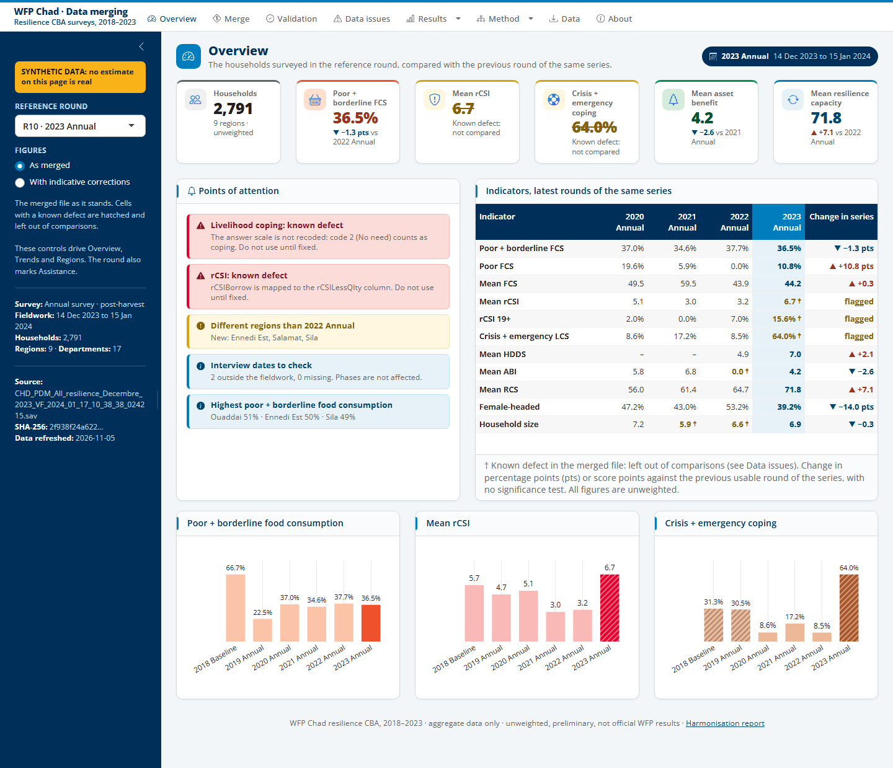

# WFP Chad data merging dashboard (R Shiny)

The dashboard of the merging process behind the cost-benefit analysis of WFP's resilience interventions in Chad, 2018 to 2023. It shows how 10 household survey rounds became one dataset of 17,255 households and 739 columns, including the 19 modules added in November 2026 (do-files 16 to 20 and 22) and the costs per household (do-file 21), and how far that dataset can be trusted.

> **No household-level data.** The app holds only variable metadata, check results and aggregate indicators by round and region. It has no household ID, village name or GPS coordinate, and regional cells under 30 households are suppressed. Figures are unweighted and preliminary, not official WFP results.



## Pages

The **reference round** and the **figures** option in the left panel drive Overview, Trends and Regions. The round also marks Assistance.

| Page | Question it answers |
|---|---|
| **Overview** | What do the figures of this round say, and what should I check first? |
| **Merge** | Is every household and column accounted for? Rows from raw file to merged file, each merge step, which module reaches which round, Cadre Harmonisé link, place names |
| **Validation** | Do the data match their sources? All checks, what the defects do to the indicators, rCSI against the analysts' rCSI, coping strategies by round |
| **Data issues** | What was found, where does it come from and what should be done? |
| **Variables** | What does each of the 305 merged columns hold? Label, completeness and distribution by round. Columns that can identify households show their completeness only, and answers from fewer than 5 households are hidden |
| **Results** | *Trends*, *Regions*, *Assistance* and *Costs*: indicators over time and by region; the 20 intervention variables with their recoding audit; WFP's costs reconciled, grouped by activity and linked to the surveys by department and year, and the costs per household of the merged file (by intervention, asset type, region and round, with the ledger of the community template) |
| **Method** | *Approach*, *Process* (pipeline diagram), *Crosswalk* (217 variables x 10 rounds, downloads), *Rounds* (fieldwork, inventory, departments) |
| **Data** | Filter the aggregate indicators and download them as CSV or Excel |
| **About** | How to refresh, data statement, SHA-256 of each input |

## How figures are shown

- **As merged, by default.** Figures come from the merged file as it stands. The app never changes the pipeline's files.
- **Known defects are flagged.** Those cells are hatched or marked †, and left out of comparisons, so that a defect does not read as a change.
- **Indicative corrections, as an option.** They show what a fix would change, rebuilt from the raw files. They need review before any use, and are not a substitute for fixing the pipeline.
- **Two series.** Each round is compared with the previous one of its series: lean season (PDM) or post-harvest (baseline and annual surveys). Rises are not coloured as good or bad, and there is no significance test.

## Run locally

Requires R 4.3 or later. On Windows, double-click `run_app.bat`: it installs what is missing and opens the browser. In RStudio or Positron: open `app.R`, then **Run App**. No login is asked in these cases. In any non-interactive run (`Rscript`, a server), the app **requires a login and refuses to start without accounts**; for a local `Rscript` run, set `WFP_CBA_LOCAL=1`.

Tested with R 4.5.2, shiny 1.14.0, bslib 0.11.0, plotly 4.12.0, reactable 0.4.5, visNetwork 2.1.4, shinyWidgets 0.9.1.

## Refresh the data

`data/` is generated and not versioned. After a change in the cost data, first run the scripts of `costs/` from the repository's root, in the order of [costs/README.md](../costs/README.md), then do-file 21. After a change in the pipeline, from this folder:

```bash
Rscript prepare_app_data.R     # needs haven, readxl, digest in addition to the app's packages
Rscript tests/test_app.R       # every page, the figures, the issue claims, the data boundary, the login
```

`prepare_app_data.R` reads the raw SPSS files, the workbook, the module files and the merged file, all read-only. It replays the merge, compares raw and merged values, recomputes the scores and writes aggregates. **Checks and flags are computed from the data, so a fix in the pipeline clears them by itself.** Two things stay by hand:

- `config/issues.csv` holds the text of the Data issues page. The tests check its main figures and fail when they no longer hold: update the text, then the test.
- `FINAL_FILE` at the top of `prepare_app_data.R` names the merged file. Folders can be changed with `WFP_INPUT_DIR`, `WFP_MODULES_DIR` and `WFP_MERGED_DIR`.

## Synthetic mode

For screenshots and demonstrations, with invented estimates and a banner saying so:

```bash
Rscript make_demo_data.R       # builds demo_data/ (not versioned)
```

Then run the app with `WFP_CBA_DEMO=1`. The screenshots in this folder are taken this way, with `tests/take_screenshots.R`, so their estimates are invented; household counts by round and department are real.

`data/` is not versioned, but `config/issues.csv` and `tests/test_app.R` do quote real round-level figures, as they document the defects found in the merged file.

## Share with the team

1. **Publish with a login** on shinyapps.io or Posit Connect Cloud. From this folder:
   ```bash
   # Once: rsconnect::setAccountInfo(name = "...", token = "...", secret = "...")
   Rscript manage_accounts.R first.name other.name   # list ALL accounts to keep
   Rscript publish.R                                 # lists what would be sent; sends nothing
   Rscript publish.R --publish                       # sends it
   ```
   - Passwords go to `accounts_passwords.csv`. Send each one individually through a safe channel, then delete that file.
   - `publish.R` sends only the files on its allow-list, and refuses to run without accounts or if a file looks like household data.
   - **Before sending the link,** open it in a private browser window: you should see the login page, with no data.
2. **Zip this folder** (with `data/`) and share it; recipients double-click `run_app.bat`. Leave out `accounts.sqlite`, `accounts_passwords.csv` and `.Renviron`.

Check with the data owners (WFP) before sharing regional figures outside the team.

## Structure

```
app/
├── app.R                 page layout, reference round and server wiring
├── R/                    loaded automatically by Shiny
│   ├── data.R            loads the aggregates and metadata
│   ├── utils.R           theme, indicator catalogue, comparison rule, chart style
│   ├── auth.R            login: required on a server, refuses to start without accounts
│   └── mod_*.R           one module per page
├── config/               rounds, modules, interventions, text of the issues
├── www/                  styles (WFP Visual Brand Guide v6.0 colours) and Open Sans (OFL.txt)
├── tests/                test_app.R, take_screenshots.R
├── data/                 generated by prepare_app_data.R (not versioned)
├── prepare_app_data.R    from the pipeline's files to aggregates and checks
├── make_demo_data.R      synthetic estimates for screenshots
├── manage_accounts.R     creates the login accounts
└── publish.R             publishes from an allow-list; a dry run by default
```
