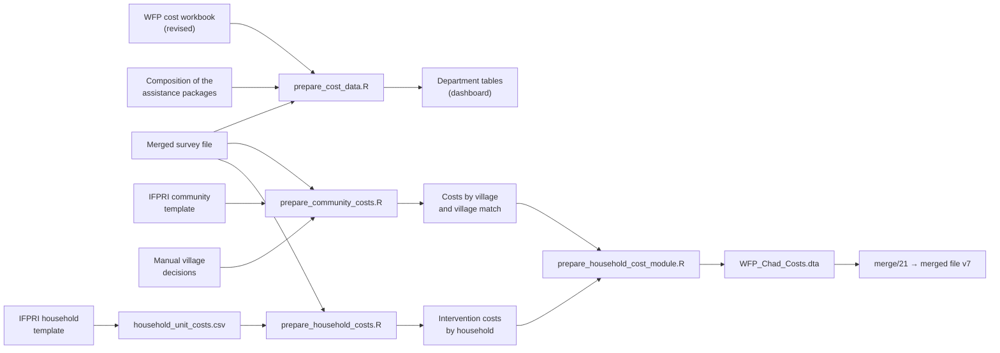

# Resilience cost data

This folder turns WFP's resilience cost data into clean tables for the cost-benefit analysis. It reconciles the costs, groups them by activity, links them to the surveys by department and year, and spreads the community costs over villages matched to the surveyed villages.

**Status (10 November 2026).**
- **Department costs:** done; they feed the dashboard.
- **Community costs by village and the village match:** done. The first manual review (23 cost villages) was validated on 10 November 2026.
- **Costs of household-level interventions:** done, converted to XAF at the World Bank's annual rates.
- **Household cost module (step 4):** done. Merged by do-file 21 into `WFP_Chad_2018-2023_20261110_v7.dta` (17,255 households, 670 columns: the 626 earlier columns unchanged and 44 cost variables), and carried into v8 by do-file 22. Every franc of the cost files is accounted for: see [No loss of information](#no-loss-of-information).

## At a glance



| Step | Script | Status | Output |
|---|---|---|---|
| Department costs | `prepare_cost_data.R` | Done, feeds the dashboard | Reconciled lines, tables by category, area and partner, link to the surveys |
| 1. Community costs by village | `prepare_community_costs.R` | Done | Transfer and capacity costs by village and period |
| 2. Match to the surveyed villages | `prepare_community_costs.R` | Done; first manual review applied | Each cost village and its surveyed village(s) |
| 3. Costs of household-level interventions | `prepare_household_costs.R` | Done | Cost per household from the interventions it reports |
| 4. Household cost module | `prepare_household_cost_module.R`, `merge/21_WFP_Chad_add_costs.do` | Done | 44 cost variables in the merged file (v7) |

## Source files

All in `CBA - Chad/data/cost data/`, read-only. None is in this repository.

| File | From | Content | Used by |
|---|---|---|---|
| `Cost related data_ Resilience 2019-2023 revised.xlsx` | WFP | One sheet per period: sub-office, province, department, partner, activity, unit, outcome, amount ("Cash", XAF), beneficiary households | `prepare_cost_data.R` |
| `Composition de packet d'assistance integrated resilience.xlsx` | WFP | Rations of school feeding, lean season and nutrition: grams per person per day, value per person per month (USD) | `prepare_cost_data.R` |
| `TEMPLATE_Community (resilience)_20241216.xlsx` | IFPRI, filled with WFP | The same cost lines, plus the **villages** of each line and the cost **split into transfer and capacity costs**; the rule to assign costs to households | `prepare_community_costs.R` |
| `TEMPLATE_Household resilience_20241219.xlsx` | IFPRI, filled with WFP | Full cost per household-level intervention, exposure period and beneficiary unit, with WFP's answers to IFPRI's questions | Copied into `household_unit_costs.csv` (step 3) |
| `village_matches_manual.csv` | IFPRI | A person's decisions on village matches | `prepare_community_costs.R` |
| `village_matches_proposed.csv` | IFPRI | The first review as proposed, kept for the record (all of it is now in the manual file) | Not read |

## Run it

From the repository's root, in this order:

```bash
Rscript costs/prepare_cost_data.R          # department costs
Rscript costs/prepare_community_costs.R    # community costs by village and village match
Rscript costs/prepare_household_costs.R    # costs of the household-level interventions
Rscript costs/prepare_household_cost_module.R   # the cost module, WFP_Chad_Costs.dta
# then merge/21_WFP_Chad_add_costs.do in Stata, which writes the merged file v7
Rscript app/prepare_app_data.R             # then the dashboard (from app/, see app/README.md)
```

The scripts read the merged survey file read-only and write to `CBA - Chad/data/cost data clean/`, outside this repository. Cost lines and village names stay out of the repository and the dashboard, because activity texts and village names identify places below the department.

## Department costs: `prepare_cost_data.R`

### Rules

- **Currency.** Costs are in XAF. The composition file's values per person per month are in USD; they are not converted, as no exchange rate was provided.
- **2020.** January to March (activities) and April to December (lump sums per partner, because of COVID-19) stay separate periods. A lump sum sits on a partner's first row, which says nothing about that row's activity, so it is never split across activities.
- **Subtotals.** Subtotal rows are left out, including Farchana's, which have no label. Every labelled subtotal is checked against its lines.
- **Categories.** Activities are grouped by keyword rules (`activity_categories.csv`, 14 rules, the first match wins).
- **Link to the surveys.** Costs link to surveyed households by cost area (department, or two departments combined) and year, through `department_crosswalk.csv`, not by household.

### Reconciliation (XAF)

| Period | Basis | Lines | WFP total | Reconciled | Difference |
|---|---|---:|---:|---:|---:|
| 2019 | Activity | 107 | 1,685,613,233 | 1,897,116,750 | 211,503,517 |
| 2020 Jan-Mar | Activity | 56 | 337,193,470 | 337,193,470 | 0 |
| 2020 Apr-Dec | Partner lump sum | 184 | 2,350,967,290 | 2,350,967,290 | 0 |
| 2021 | Activity | 120 | 1,087,127,870 | 1,087,127,870 | 0 |
| 2022 | Activity | 118 | 909,909,128 | 909,909,128 | 0 |
| 2023 | Activity | 108 | 2,046,970,541 | 2,046,970,541 | 0 |
| **All** | | **693** | **8,417,781,532** | **8,629,285,049** | **211,503,517** |

Only 2019 differs: WFP's `TOTAL GENERAL` formula leaves out Farchana (211,503,517 XAF).

### Outputs

| File | Content | In the dashboard |
|---|---|---|
| `cost_lines.csv` | One row per cost line, with category, cost area and region | No (names villages) |
| `cost_reconciliation.csv` | The table above | Yes |
| `cost_by_category.csv`, `cost_by_area.csv`, `cost_by_partner.csv` | Totals by activity category, cost area and partner | Yes |
| `cost_lump_sum_activities.csv` | Activities listed under the 2020 lump sums | Yes |
| `cost_survey_link.csv` | Costs and surveyed households by cost area and year | Yes |
| `cost_department_crosswalk.csv` | Copy of the crosswalk | Yes |
| `composition_usd.csv` | Rations and values per person per month (USD) | Yes |

## Step 1, community costs by village: `prepare_community_costs.R`

- **Blocks.** A cost covers its row and the rows below it in the same partner block, until the next row with a cost of the same kind. A row with no village takes the villages of the row above, within the partner block.
- **Split.** A block's cost is split **equally** between its villages, because no village weights are given (an assumption). Transfer and capacity costs are split separately, and so are WFP's beneficiary households.
- **No village.** 14 blocks name no village (148,166,439 XAF); they stay at department level.
- **Checks.** Every transfer subtotal is checked against its lines, and the split must keep every franc. Two quirks of the template are accepted and recorded: Excel's SUM skips amounts typed as text ("1 450 500", Mao 2023), and Farchana's subtotal has no label (2020 April-December).
- **Template quirks handled.** A stray number in place of the Mao sub-office (2022) is replaced by the department's sub-office, and the Moussoro block of 2022 that names no partner is kept as "(NOT GIVEN)".

### Template totals (XAF)

| Period | Transfer cost | Capacity cost | Revised workbook | Transfer minus revised |
|---|---:|---:|---:|---:|
| 2019 | 1,753,869,559 | 1,086,984,862 | 1,897,116,750 | −143,247,191 |
| 2020 Jan-Mar | 337,193,470 | 644,674,545 | 337,193,470 | 0 |
| 2020 Apr-Dec | 3,221,136,678 | 1,047,133,682 | 2,350,967,290 | 870,169,388 |
| 2021 | 1,087,127,870 | 1,169,071,788 | 1,087,127,870 | 0 |
| 2022 | 1,739,160,928 | 1,458,775,918 | 909,909,128 | 829,251,800 |
| 2023 | 2,151,598,603 | 1,719,577,105 | 2,046,970,541 | 104,628,062 |

The capacity cost (7.1 billion XAF over 2019-2023) is new: the revised workbook has no such column.

## Step 2, match to the surveyed villages

The merged file has 321 surveyed villages. Names are compared once written plainly (capitals, no accents or punctuation; areas such as "30HA" removed), within the surveyed departments the cost department maps to, in this order:

1. **Same name.**
2. **Surveyed name + suffix**: the surveyed name followed by a site or neighbourhood (a site or hamlet name added after the village name).
3. **Close name**: Jaro-Winkler distance up to 0.12. Every close spelling is kept, one row each, because the surveys spell one village several ways.
4. **Same name, other department** in the same region.

| Match | Cost villages |
|---|---:|
| Same name | 100 |
| Surveyed name + suffix | 27 |
| Close name | 62 |
| Same name, other department | 2 |
| Checked by hand: linked | 21 |
| Checked by hand: not a surveyed village | 2 |
| Not surveyed | 199 |
| No surveyed department (Iriba, Dougouba) | 12 |
| **All** | **425** |

Surveyed households living in a village with community costs in the same year:

| 2019 | 2020 | 2021 | 2022 | 2023 |
|---:|---:|---:|---:|---:|
| 47.9% | 84.1% | 67.1% | 71.6% | 49.1% |

### Manual review

Two lists, in `cost data clean/`:

- `community_village_match_to_review.csv`: the 94 automatic matches that are not an exact name, to confirm or reject.
- `community_survey_villages_unmatched.csv`: the 149 surveyed villages (4,304 households) of a cost department with no cost village, with the nearest cost name, to catch missed matches.

Decisions go in `cost data/village_matches_manual.csv`:

| Column | Content |
|---|---|
| `department` | Department as written in the template |
| `cost_village` | Cost village, as in the match file |
| `survey_village` | Surveyed village; empty means "checked, not a surveyed village" |
| `adm2_ocha` | Optional, when the surveyed name exists in several departments |
| `decided_by`, `note` | Who decided, and why |

All rows of a cost village replace its automatic matches: one row links one surveyed spelling, several rows link several. Then rerun the script.

**First review, validated on 10 November 2026.** The 40 proposed rows for 23 cost villages were accepted as proposed and copied into the manual file (`decided_by`: "proposal accepted by AH, 2026-11-10"). They are in the merged file from v7 on:
- **Rejections and corrections:** 4 cost villages, where the closest spelling is another village. Two hamlets of a surveyed village are now "not a surveyed village"; two names keep only the surveyed village closer in sound.
- **Lists without separators:** 11 cost "villages" are two or three villages written without a separator; each surveyed village among them is linked.
- **Surveyed spellings that were missed:** 8 cost villages gain a spelling used in one survey round.

Effect: 69 households move to their village's own cost (63 had the cost area average, 6 had no community cost), and 207.6 million XAF more transfer cost reaches a surveyed village in its survey year (see the ledger below). The 2,114 households with an unknown cost are unchanged: their cost area has no cost, which no village decision can change.

To try other decisions without changing the manual file: `WFP_VILLAGE_DECISIONS="<path to a decisions file>" Rscript costs/prepare_community_costs.R`. This rewrites the clean tables, so rerun with the manual file afterwards.

Still open, left automatic: 6 doubtful close spellings and 2 names surveyed only in another department. They are in `community_village_match_to_review.csv`, outside the repository, as village names stay out of it.

### Outputs

| File | Content |
|---|---|
| `community_cost_lines.csv` | Template lines with villages, transfer and capacity costs, and a flag where the capacity cost repeats the transfer cost |
| `community_cost_blocks.csv` | Each cost block: kind, amount, rows, villages |
| `community_village_costs.csv` | Transfer and capacity costs and beneficiary households by village and period |
| `community_village_match.csv` | Each cost village and its surveyed village(s), with the kind of match |
| `community_village_match_to_review.csv`, `community_survey_villages_unmatched.csv` | The two review lists |
| `community_survey_coverage.csv` | Surveyed households in a village with community costs, by year |
| `community_vs_revised.csv` | Template totals against the revised workbook |
| `community_capacity_equals_transfer.csv` | Partner blocks where the capacity cost repeats the transfer cost |
| `community_village_costs_by_asset.csv` | Transfer and capacity costs by village, period and asset type |
| `community_cost_ledger.csv` | Where every franc of the template goes, by period (see below) |

## Step 3, costs of the household-level interventions: `prepare_household_costs.R`

For each household surveyed from 2019 on, and each intervention it answers "yes" to (code 1):

> cost = units × amount × months

The amounts, units and months are in [`household_unit_costs.csv`](household_unit_costs.csv), one row per intervention and year (or `all`), with a `status`: `template` (WFP's figure), `assumed`, `approximation`, `to confirm` or `decision`.

| Unit rule | Units |
|---|---|
| `household`, `one_person`, `one_woman` | 1 |
| `persons_6` | 6, WFP's operational household size |
| `children_6_23m` | Children aged 6-23 months, at least 1 |
| `children_5_14` | Children aged 5-14, at least 1: an upper bound for primary-school children, as the surveys have no 6-11 band |
| `child_and_woman` | At most one child aged 0-59 months plus at most one woman aged 15-49, at least 1 |

**Assumptions beyond the template:**
- **Combined questions (2019 to 2021 PDM).** "Children or women" is costed as children. "MAM or MAS" is costed as one MAM treatment, as MAS is UNICEF's. "School meals or bursaries" is costed as school meals.
- **Lean season, food or cash in one question (2019 to 2021 PDM, 1,214 households).** Costed as cash, the lower cost (decision of 8 November 2026). WFP gives no 2019 cash amount, so 2019 takes the 2020 amount (44.5 USD a month).
- **Treatment length.** 65 days (2.17 months), the middle of WFP's 60-70 days.
- **Not costed here.** Cash for assets, which comes from the community template (step 4).

**Currency.** `cost_usd` adds the USD items and `cost_xaf_native` the XAF items (bursaries). `cost_xaf` adds both at the year's rate in [`exchange_rates.csv`](exchange_rates.csv): the World Bank's official rate, annual average (indicator PA.NUS.FCRF, Chad), from 554.5 XAF per USD in 2021 to 623.8 in 2022.

| Output | Content |
|---|---|
| `household_intervention_costs.csv` | One row per household (ID, year, survey): cost of each intervention, totals in USD and XAF, number of interventions costed and not costed |
| `household_intervention_costs_by_item.csv` | By intervention: households saying yes, costed, total and mean cost |
| `household_intervention_costs_by_round.csv` | By round: households with a cost and mean costs |

## Step 4, household cost module: `prepare_household_cost_module.R` and `merge/21`

**Decisions of 8 November 2026:**
- **Transfer costs.** The community template is the reference where it differs from WFP's revised workbook: it is the only file with villages and the transfer and capacity split.
- **Households per village.** WFP's beneficiary households of the village (the template's Menage column), for both costs.
- **Exchange rate.** The World Bank's official annual average.
- **Lean season, food or cash.** Costed as cash.

**Community costs.** They follow the template's rule, with costs of year Y applied to households surveyed in year Y (2020: both periods together):

| Household | Community cost |
|---|---|
| Took part in cash for assets (or food for assets, recoded), village with costs | Transfer cost / beneficiaries + capacity cost / beneficiaries |
| Did not take part, village with costs | Capacity cost / beneficiaries |
| Village without matched costs that year | 0 |
| Took part, but village without matched costs | Cost area and year average per beneficiary (transfer + capacity) |
| Village with costs but no beneficiary count | Cost area and year average per beneficiary (capacity, plus transfer for participants) |

A surveyed village linked to several cost villages pools them: the cost per beneficiary is the ratio of the sums. The cost is missing (`cost_comm_source = 3`) only when the cost area has no cost or no beneficiary count that year: 2,114 households, listed in the issue register. It is never guessed.

**Variables added to the merged file (v7).** 44 in all, each described (group, unit, source, rule) in [`cost_variables.csv`](cost_variables.csv):

| Group | Variables | What they hold |
|---|---:|---|
| Community cost | 4 | Source, transfer and capacity cost per household, flag for repeated capacity costs |
| Community cost by asset type | 13 | The community cost per household, by asset type; they add up to transfer + capacity |
| Household-level interventions | 13 | One column per survey question; they add up to `cost_interv_xaf` |
| Totals | 3 | Interventions in USD and XAF, and the total cost per household in XAF |
| Context: village | 7 | The village's costs and beneficiaries in the survey year, and cumulated from 2019 |
| Context: cost area | 4 | The cost area's costs and beneficiaries in the survey year (template), and its cost in WFP's revised workbook |

| Variable | Content |
|---|---|
| `cost_comm_source` | 0 no village cost, 1 village, 2 cost area average, 3 unknown; missing in 2018 |
| `cost_comm_transfer_xaf` | Community transfer cost per household, XAF (cash for assets) |
| `cost_comm_capacity_xaf` | Community capacity cost per household, XAF |
| `cost_comm_repeat` | 1 when the village's capacity cost includes rows that repeat the transfer cost |
| `cost_asset_land_xaf` | Community cost, asset type: land recovery (dikes, half-moons, anti-erosion) |
| `cost_asset_trees_xaf` | Trees, nurseries and dune fixation |
| `cost_asset_water_xaf` | Water: wells, ponds, dams, irrigation |
| `cost_asset_garden_xaf` | Market gardening and crops |
| `cost_asset_hygiene_xaf` | Household hygiene and improved stoves |
| `cost_asset_compost_xaf` | Compost and soil fertility |
| `cost_asset_roads_xaf` | Roads, buildings and maintenance |
| `cost_asset_training_xaf` | Training and capacity building |
| `cost_asset_school_xaf` | School support |
| `cost_asset_storage_xaf` | Cereal banks and storage |
| `cost_asset_livestock_xaf` | Livestock and fish |
| `cost_asset_other_xaf` | Activities the keyword rules do not classify |
| `cost_asset_lump2020_xaf` | 2020 April-December lump sums (COVID-19), not allocated to an activity |
| `cost_lean_food_xaf`, `cost_lean_cash_xaf`, `cost_lean_combined_xaf` | Lean-season food, cash, and the combined question (2019 to 2021 PDM) |
| `cost_blanket_children_xaf`, `cost_blanket_women_xaf`, `cost_blanket_combined_xaf` | Blanket feeding (prevention): children, women, combined question |
| `cost_mam_children_xaf`, `cost_mam_women_xaf`, `cost_mam_combined_xaf` | Malnutrition treatment: children, women, combined question |
| `cost_farn_xaf` | Community nutrition rehabilitation (FARN) |
| `cost_school_meals_xaf`, `cost_school_combined_xaf` | School meals, and the combined question with bursaries (2020 PDM) |
| `cost_bursary_xaf` | Bursaries for adolescent girls |
| `cost_interv_usd`, `cost_interv_xaf` | Sum of the household-level interventions, USD and XAF |
| `cost_total_xaf` | Community plus household-level costs, XAF |
| `cost_vill_transfer_xaf`, `cost_vill_capacity_xaf`, `cost_vill_benef` | The village's costs and beneficiaries in the survey year |
| `cost_vill_cum_transfer_xaf`, `cost_vill_cum_capacity_xaf`, `cost_vill_cum_benef`, `cost_vill_cost_years` | The same, cumulated from 2019 to the survey year, and the years with costs |
| `cost_area_transfer_xaf`, `cost_area_capacity_xaf`, `cost_area_benef` | The cost area's costs and beneficiaries in the survey year, including blocks with no village |
| `cost_area_revised_xaf` | The cost area's cost in WFP's revised workbook |

Each intervention column is 0 when the household said no and missing when the round did not ask the question. The intervention columns add up to `cost_interv_xaf`; cash for assets is the community transfer cost.

**Asset types.** Each template line is classified with the department rules (`activity_categories.csv`). A cost that covers several activity rows (a partner's capacity cost on its first row, for example) is shared equally between those rows, then between the villages. The asset columns follow the same household rule as the community cost, so they add up to `cost_comm_transfer_xaf + cost_comm_capacity_xaf`; the scripts check it. Costs by village and asset type are in `community_village_costs_by_asset.csv`.

| Asset type | Transfer cost, XAF | Capacity cost, XAF |
|---|---:|---:|
| 2020 lump sums, not allocated | 3,221,136,678 | 1,047,133,682 |
| Land recovery: dikes, half-moons, anti-erosion | 1,882,910,946 | 1,888,736,442 |
| Trees, nurseries and dune fixation | 1,288,109,365 | 1,104,282,806 |
| Water: wells, ponds, dams, irrigation | 1,452,188,644 | 869,392,793 |
| Market gardening and crops | 964,888,185 | 784,985,027 |
| Household hygiene and improved stoves | 611,657,587 | 536,141,972 |
| Compost and soil fertility | 240,773,588 | 250,985,853 |
| Other or unclear | 226,892,000 | 224,134,108 |
| Roads, buildings and maintenance | 151,488,782 | 107,107,394 |
| Training and capacity building | 62,278,692 | 125,709,583 |
| School support | 80,896,619 | 72,225,617 |
| Cereal banks and storage | 56,885,860 | 72,843,667 |
| Livestock and fish | 49,980,162 | 42,538,956 |

**Mean costs by round, XAF:**

| Round | Transfer | Capacity | Interventions | Total | Households with a total |
|---|---:|---:|---:|---:|---:|
| 2019 Annual | 53,448 | 34,500 | 104,659 | 201,415 | 522 of 775 |
| 2020 PDM | 94,833 | 61,285 | 196,950 | 337,552 | 237 of 271 |
| 2020 Annual | 206,127 | 43,890 | 111,061 | 358,869 | 1,034 of 1,063 |
| 2021 PDM | 23,883 | 47,642 | 151,431 | 217,327 | 745 of 786 |
| 2021 Annual | 14,715 | 49,745 | 168,072 | 193,698 | 1,253 of 1,431 |
| 2022 PDM | 45,400 | 72,338 | 329,142 | 430,079 | 1,210 of 1,579 |
| 2022 Annual | 52,439 | 94,959 | 249,100 | 406,883 | 1,537 of 1,712 |
| 2023 PDM | 30,671 | 89,499 | 237,770 | 368,326 | 2,537 of 2,868 |
| 2023 Annual | 43,391 | 170,622 | 232,301 | 467,273 | 2,087 of 2,791 |

Transfer means are over all households, participants or not. For participants with a village cost, the median transfer is 46,267 XAF, against the 30,000 XAF they receive in hand. The difference is the delivery cost included in WFP's full cost.

**Read with care:**
- **2020.** The April-December lump sums (COVID-19) are partner totals spread over few declared beneficiaries, which raises the 2020 transfer cost.
- **Repeated capacity costs.** Households with `cost_comm_repeat = 1` (1,613 from 2021 on) carry capacity costs that may be a copied column: to confirm with WFP.
- **Beneficiaries as the denominator.** WFP's beneficiaries undercount a village's households, so the capacity cost per household is an upper bound.

## Household-level unit costs (reference)

The household template gives WFP's full cost per intervention:

| Intervention (survey variable) | Full cost | Exposure | Unit |
|---|---|---|---|
| ArgentContreTravail (cash for assets) | 30,000 XAF | 20 days | Household; assigned through the community template |
| DistribVivresSoudure (lean-season food) | 31.75 USD per month | 3 months | Person, 6 per household assumed |
| DistribArgentSoudure (lean-season cash) | 89 USD per month (44.5 in 2020; 2019 to confirm) | 3 months | Household |
| CantineScolaire (school meals, food) | 7.5 USD per month | 9 months | Child aged 6-11 |
| BoursesAdo (girls' excellence awards) | 20,000 XAF | Once | Laureate |
| BlanketFeedingChildren | 17 USD per month | 8 months | Child aged 6-23 months |
| BlanketFeedingWomen | 17 USD per month | 6 months | Pregnant or lactating woman |
| MAMChildren, MAMPLWomen (treatment) | 21.7 USD per month | 60-70 days | At most one per household |
| FARNcommunaut | 39 USD per month | 2 months | One child and one woman at most |

Ignored, as agreed with WFP: CashTransfert and AutreTransferts (not WFP assistance) and MASChildren (UNICEF). VivreContreTravail is recoded to cash for assets. BanqueCerealiere and FormationRenfCapacite are costed in the community template.

The community template's rule assigns the community costs to households:

| Took part in cash for assets | Village with assets created | Cost assigned |
|---|---|---|
| Yes | Yes | Transfer cost / beneficiary households + capacity cost / households in the village |
| No | Yes | Capacity cost / households in the village |
| No | No | Zero |

The decisions on these rules are listed under step 4 above.

## No loss of information

Nothing in the cost files is dropped. Every amount, line and attribute is kept in a clean table, and every franc of the community template is traced to one destination.

**Ledger of the community template (XAF, 2019-2023).** From `community_cost_ledger.csv`, by period; the script stops if it does not add up to the template:

| Destination | Transfer cost | Capacity cost | Where it is in the merged file |
|---|---:|---:|---|
| 1. Surveyed village, same year | 5,360,683,685 | 3,661,884,607 | Per household (`cost_comm_*`, `cost_asset_*`) and in `cost_vill_*` |
| 2. Surveyed village, other years only | 2,530,920,697 | 1,826,366,334 | In `cost_vill_cum_*` for later surveys of the village |
| 3. Village not surveyed | 2,203,889,787 | 1,637,966,959 | In the cost area totals (`cost_area_*`) |
| 4. No village named | 148,166,439 | 0 | In the cost area totals (`cost_area_*`) |
| 5. Department not surveyed (Iriba, Dougouba) | 46,426,500 | 0 | Not in the merged file: no household there; kept in the clean tables |
| **Total, equal to the template** | **10,290,087,109** | **7,126,217,899** | |

**Where each source's information is kept:**

| Source | Information | Kept in |
|---|---|---|
| Revised workbook | Every line: sub-office, department, partner, activity, unit, outcome, amount, households | `cost_lines.csv`; totals in the dashboard tables; the area amount in `cost_area_revised_xaf` |
| Composition file | Rations and values per person per month | `composition_usd.csv` (dashboard) |
| Community template | Every line, with villages, transfer and capacity costs, households, and the repeated-cost flag | `community_cost_lines.csv`, `community_cost_blocks.csv`, village and asset tables; per household in the merged file |
| Community template | Rows with an activity but no amount (covered by an amount above them) | `community_cost_lines.csv`; their activity shares the block's cost |
| Household template | Full cost, exposure, unit, WFP's answers | `household_unit_costs.csv` (with a status per row) and this README |
| Merged survey file | The interventions households report | The 20 intervention variables stay unchanged; their costs are added beside them |
| Village decisions | Automatic and manual matches | `community_village_match.csv`, the review lists, `village_matches_manual.csv` |

**What the merged file cannot hold, and why:**
- **Village names and activity texts.** These identify places below the department, so they stay in the clean tables, outside the repository and the release. The amounts derived from them are in the merged file.
- **Costs of non-WFP assistance.** CashTransfert and AutreTransferts are not WFP's, and MASChildren is UNICEF's. Their survey answers stay in the merged file, without a cost.
- **A cost per household where none can be computed.** 2,114 households (`cost_comm_source = 3`) live in an area with no cost or no beneficiary count that year. Their area totals, where they exist, are still in `cost_area_*`.

The data issues behind these figures are in the dashboard's issue register (`app/config/issues.csv`): repeated capacity costs, the template against the revised workbook, areas with no cost data, template quirks, combined questions, and equal sharing between villages and activities.

## Editable rules

| File | Content |
|---|---|
| [`department_crosswalk.csv`](department_crosswalk.csv) | Each department as written in the cost files, its survey departments and OCHA codes, and how sure the link is |
| [`activity_categories.csv`](activity_categories.csv) | Keyword rules for the activity categories, in order: the first match wins. Set `WFP_COST_AUDIT=1` to print the unclear rows and the largest lines of each category |
| [`household_unit_costs.csv`](household_unit_costs.csv) | Unit cost, currency, unit rule and months of each household-level intervention, by year |
| [`exchange_rates.csv`](exchange_rates.csv) | XAF per USD by year, with its source (World Bank) |
| [`cost_variables.csv`](cost_variables.csv) | Dictionary of the 44 cost variables: group, unit, source and rule. The module script stops if it disagrees with the variables written |
| `cost data/village_matches_manual.csv` | Manual village decisions (outside the repository, as it names villages) |

## Stops

The scripts stop rather than write wrong tables when:
- a subtotal disagrees with its lines;
- a department has no crosswalk entry (department costs);
- a table or the village split loses money;
- the survey link loses households;
- a line has no sub-office or partner;
- a manual decision names a surveyed village that does not exist;
- a unit cost has an unknown unit rule or currency, or household IDs are not unique (household costs);
- the ledger, the asset types or the intervention columns do not add up to their totals;
- `cost_variables.csv` does not describe exactly the variables of the module;
- in Stata (do-file 21): a household does not match, a 2019-2023 household has no cost source, or a cost is negative.

## To confirm with WFP

- **2019 total.** WFP's total leaves out Farchana (211,503,517 XAF).
- **Template against revised workbook.** The transfer costs agree in 2020 January-March and 2021 only. In 2022 the difference (829,251,800 XAF) is exactly a Moussoro block that names no partner and is missing from the revised workbook.
- **Capacity cost repeating the transfer cost.** In 85 rows of 9 partner blocks (Mao 2021 to 2023, Moussoro 2022 and 2023), 1,253,073,586 XAF in all. Possibly a copied column.
- **Department links.** Two are assumed: Ennedi Est to Wadi Hawar, and Sila to Kimiti. "Iriba, Dougouba" matches no surveyed department.
- **Surveyed departments with no cost data.** Aboudeia, Bahr-Azoum, Fitri, Nord Kanem and Wayi. Barh-El-Gazel Ouest has costs only in the template's combined 2022 Moussoro block.
- **Questions left open in the templates.** Households per village; whether asset creation can have no capacity cost; how to share the costs of lines that group several villages.

## Limits

- Department costs link to surveys by cost area and year, not by household. Combined areas, such as Guera + Mangalme, hold one amount for two departments.
- WFP's beneficiary households are not used for a cost per household at department level: they are missing in some periods and can count a household under several activities.
- Community costs are split equally between the villages of a line. A different weighting (for example by beneficiaries) would change the cost per village, though not the totals.
- The surveys are samples: about half of the cost villages are not surveyed. A household's cost per household uses its survey year only; earlier years of its village are in `cost_vill_cum_*`.
